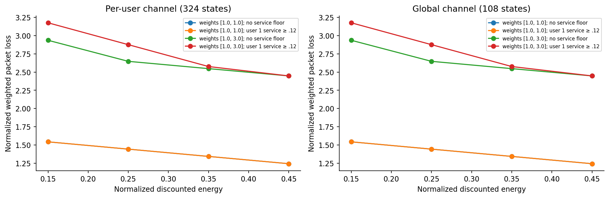
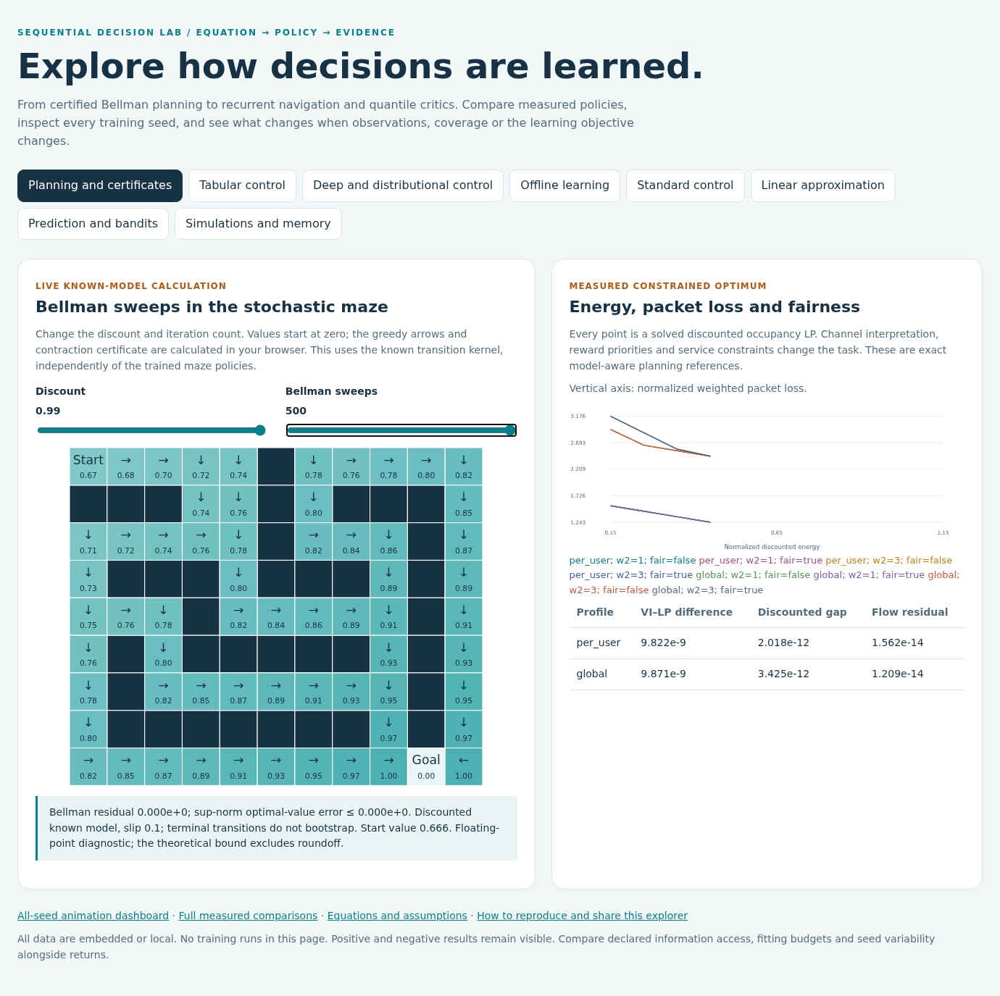
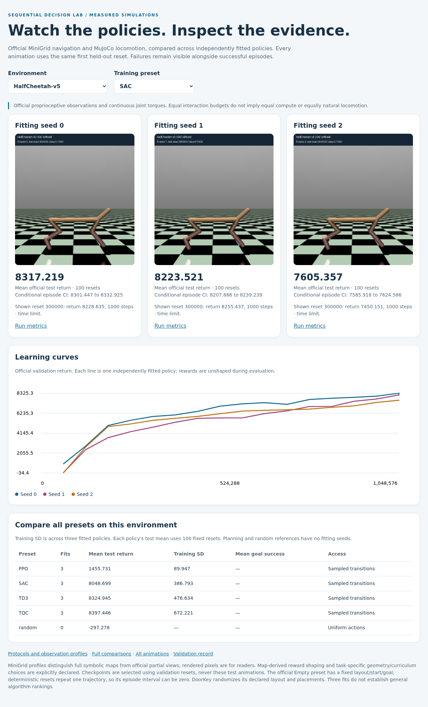
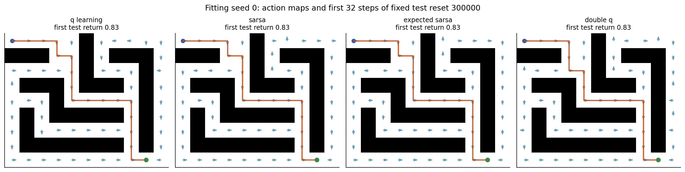

# Sequential Decision Lab

[Interactive demo](https://navidbagheri7.github.io/sequential-decision-lab/) · [GitHub repository](https://github.com/navidbagheri7/sequential-decision-lab) · [CI checks](https://github.com/navidbagheri7/sequential-decision-lab/actions)

Reinforcement learning for an energy-harvesting wireless scheduler, supported by exact planning certificates, owned online and offline learning algorithms, and repeated control experiments. This repository rebuilds incomplete course projects into an English, reproducible research portfolio.

The central question is practical: **how close does a policy learned from transitions get to a model-aware optimum, and what happens when its training data or environment changes?** The wireless simulator and analytical transition kernel share one outcome function, making that question measurable rather than anecdotal.



Open the [eight-concept explorer](docs/explorer.html) to inspect planning, deep and offline control, distributional critics, memory, bandits and recorded simulations. Live maze Bellman sweeps solve a declared known model; all trained curves and rollouts come from fitted policies.



The [user interaction audit](docs/demo_review.md) documents exhaustive enabled
dropdown checks, representative joint slider settings and source-bound asset checks.

## What is implemented

| Study | Methods | Evidence |
|---|---|---|
| Original wireless scheduling project | 324-state per-user and 108-state global-channel interpretations | Stochastic kernels, conservation tests, explicitly resolved source ambiguities |
| Exact planning | Finite-horizon DP, VI, PI, Bellman LP, occupancy LP, constrained and average-reward planning | Bellman bounds, flow residuals, primal/dual agreement, energy/fairness tradeoffs |
| Finite-state control | Q-learning, SARSA, Expected SARSA, Double Q | Three fitting seeds on wireless, slippery FrozenLake, CliffWalking, Taxi and a stochastic maze |
| Owned deep control | DQN, Double DQN, double/dueling/prioritized replay, QR-DQN | Matched wireless interaction budgets, frozen targets, masks, quantile-crossing diagnostics |
| Logged-data learning | Behavior cloning, fitted DQN, discrete CQL, discrete IQL | Three action-coverage profiles, shared datasets, fixed offline budgets, weighted-priority extension |
| Official continuous-observation tasks | Maintained SB3 PPO/DQN/SAC | CartPole, LunarLander and Pendulum; held-out test and declared parameter shifts |
| Official visual simulations | PPO reward/geometry/curriculum ablations; PPO versus SAC locomotion; known-model BFS reference | MiniGrid Four Rooms, Door Key and MuJoCo HalfCheetah; three seeds, 100 held-out episodes, portable neural actors and verified GIFs |
| Quantile and memory extensions | Maintained TD3, TQC and RecurrentPPO; local-view PPO reference | Three fits per preset, sparse-reward MiniGrid Empty/DoorKey and HalfCheetah; independent portable actor replay |
| Linear approximation | Tile-coded SARSA with lambda 0 and .9 | Three seeds, official MountainCar, correct time-limit bootstrap |
| Lecture studies | Gaussian bandits; MC/TD/n-step/TD(lambda); Baird-style TD/GTD2/LSTD | Known-value error, drift sensitivity and an unclipped off-policy divergence counterexample |

See [measured results](docs/results.md), [individual fits](docs/individual_fits.csv), [theory and implementation](docs/theory.md), and [original-project mapping](docs/source_audit.md). Library baselines and owned algorithms are identified separately. This is a controlled research portfolio, not a claim of state-of-the-art benchmark performance.


This illustration uses fitting seed0 and the predetermined first test reset; its return is checked against the saved episode array.

Open the [interactive simulation dashboard](docs/simulation_dashboard.html) locally to switch tasks/presets, inspect all three fitted policies, and compare validation curves. It uses embedded numeric evidence and local GIFs, with no online service.



This is a screenshot of the working dashboard. See the [DoorKey preview](assets/previews/doorkey_desktop.png), [local-view memory preview](assets/previews/doorkey_memory_desktop.png), [FourRooms preview](assets/previews/fourrooms_desktop.png), and [mobile preview](assets/previews/doorkey_mobile.png). The website supports task/preset selection and animated rollouts. To share it as a public website after pushing this repository, follow the [GitHub Pages setup](docs/publication.md#publish-the-interactive-dashboard).

Explore the [visual simulation gallery](docs/simulation_gallery.md) for official maze navigation, key pickup/door unlocking, Taxi, slippery FrozenLake and MuJoCo locomotion. [Simulation protocols](docs/simulations.md) distinguish full-map symbolic policies, training reward shaping and known-model planning.


Door Key PPO: the same fixed test reset for all three independently fitted policies. This includes a failure, even though aggregate test success is high.

| Fitting seed0 | Fitting seed1 | Fitting seed2 |
|---|---|---|
|  |  |  |


## Install and run

Use Python 3.10–3.12 and a new environment:

```bash
python -m venv .venv
source .venv/bin/activate
python -m pip install --upgrade pip
python -m pip install -e '.[deep,control,simulations,modern,notebooks,dev]'
python -m pytest -q
```

The base install supports planning, tabular control, lecture studies and tile-coded MountainCar. `deep` adds the owned neural algorithms; `control` adds SB3 and Box2D; `simulations` adds MiniGrid and MuJoCo. On machines without a GPU, install the appropriate CPU PyTorch build. The original control protocols use CPU; GPU float32 was used for owned wireless networks and the new TD3/TQC and memory fits. Their device and model-cost differences are declared.

```bash
decision-lab planning
decision-lab tabular --seed 0
decision-lab neural --seed 0 --device cuda
decision-lab offline --seed 0 --device cuda
decision-lab control --seed 0
decision-lab simulations --seed 0
decision-lab geometry --seed 0
decision-lab curriculum --seed 0
decision-lab modern --seed 0 --device cuda:0
decision-lab approximation --seed 0
decision-lab lectures
```

Repeat fitting commands for seeds 1 and 2. Each command accepts `--config`, `--output`, and `--quick`. Quick runs through `decision-lab` go under `results/smoke`; they verify execution and are **not** the published scientific comparisons. Preserve incomplete outputs and select a fresh output directory before rerunning a failed fit. Detailed commands, budgets and environments are in [reproduction.md](docs/reproduction.md).

## Run a published policy

Finite-state deployment requires NumPy, SciPy and Gymnasium, not a neural training environment:

```bash
decision-lab rollout --policy assets/policies/tabular_Maze_q_learning_0.json --episodes 10
```

The [policy audit](docs/policy_audit.json) records fresh held-out rollouts from exports tied to local checkpoint hashes. Neural action tables preserve the fitting-device argmax. Their critic weights remain local; cross-device float32 values can differ around ties. Control checkpoint weights remain local and can be regenerated with the configurations; numeric episode evidence and validation histories are public.



The new simulation actors are distributed as compact, pickle-free NPZ weights with explicit JSON architectures. They support deterministic inference without loading private SB3 training checkpoints:

```python
from decision_lab.simulation_deployment import load_actor
from decision_lab.simulation_envs import make_environment

actor = load_actor("assets/actors/MiniGrid-DoorKey-6x6-v0_PPO_potential_0.npz")
env = make_environment(actor.metadata["case"]["env"])
observation, _ = env.reset(seed=300000)
action, _ = actor.predict(observation)
observation, reward, terminated, truncated, info = env.step(action)
env.close()
```

Every actor is checked against its original selected model on complete held-out episodes. MiniGrid policies use the declared full symbolic map; RGB rendering is for visualization.

## Inspect and reproduce the evidence

The [notebooks](notebooks/README.md) are executed English walkthroughs. They teach the equations, run small numerical checks and read the complete experiment evidence; opening them does not launch hours of training. Figures are generated from NPZ arrays and JSON records, with PNG and PDF versions.

```bash
decision-lab report
decision-lab audit
python scripts/validate_release.py
python scripts/validate_simulations.py
python scripts/validate_modern.py
```

`report` requires the complete reference protocol set. `audit` checks local checkpoint hashes and rebuilds finite-state policy exports. A fresh checkout includes exports and measured evidence; full checkpoint auditing requires fitting or restoring your local checkpoints. Independent release checks do not require those private weights.

## Scientific scope

Three fitting seeds expose variability but do not establish broad algorithm rankings. Episode bootstrap intervals condition on a fitted policy. Planning receives the transition model; learning does not. Time-limited episode returns and infinite-horizon discounted policy gaps measure different quantities. Offline priorities differ from the online task. Control algorithms have declared, unequal preset budgets. Parameter shifts are sensitivity studies, not guarantees of robustness.

Negative results are retained, including conservative offline extraction failures, poor control seeds and semigradient TD divergence. QR return quantiles are not calibrated epistemic uncertainty. The [protocol](docs/protocol.md) explains these limits and the selection rules.

Authored code is MIT licensed. Original slides, coursework and vendor material are preserved privately under ignored `legacy/originals/`; they are not redistributed. See [LICENSE](LICENSE), [CITATION.cff](CITATION.cff), and [CONTRIBUTING.md](CONTRIBUTING.md).

The [distributional and memory study](docs/modern_methods.md) documents the
new critic targets, official local-view boundaries, matched interaction budgets
and portable episodic state. Both stronger and weaker fitted seeds remain visible.
