# Visual simulation gallery

Every new learned-policy GIF shows the predetermined first held-out reset300000 for one of fitting seeds0,1,2. All three fits are included. The episode return and length are verified against public numeric evidence. BFS receives a known model and is labeled separately. Failed episodes are retained; consult the three-seed table before judging a policy from one animation.

## Navigation

### Owned stochastic maze — Q-learning

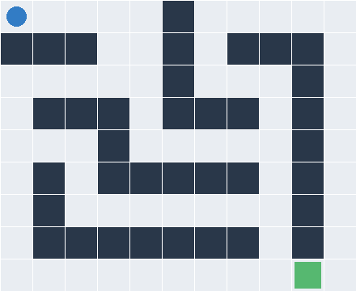

Fit 0: fixed episode return **0.830**, **18** steps.

### Official slippery FrozenLake — Q-learning

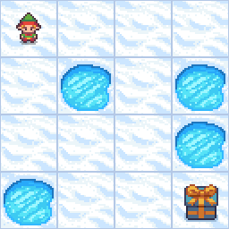

Fit 0: fixed episode return **1.000**, **49** steps.

### Official Taxi pickup and delivery — Q-learning

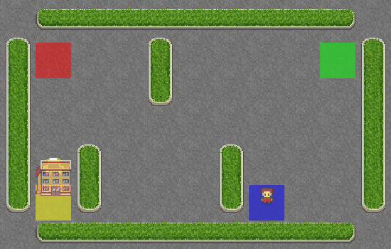

Fit 0: fixed episode return **6.000**, **15** steps.

### Official Four Rooms — PPO with geometry features and a training-start curriculum

Fit 0: fixed episode return **0.000**, **100** steps.

Fit 1: fixed episode return **0.766**, **26** steps.

Fit 2: fixed episode return **0.000**, **100** steps.

### Official Four Rooms — PPO with geometry features and potential shaping

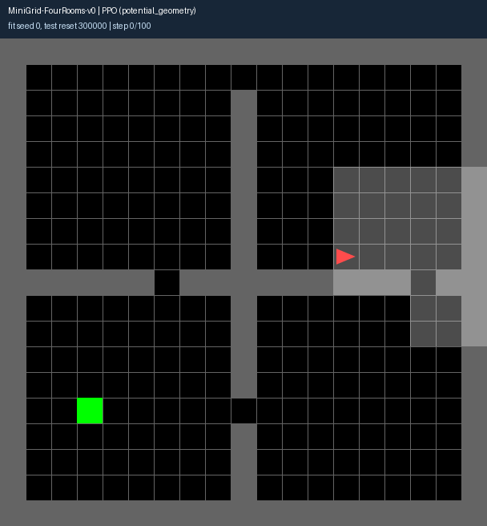

Fit 0: fixed episode return **0.000**, **100** steps.

Fit 1: fixed episode return **0.000**, **100** steps.

Fit 2: fixed episode return **0.000**, **100** steps.

### Official Door Key — fully observed PPO, potential-shaped training

Fit 0: fixed episode return **0.000**, **360** steps.

Fit 1: fixed episode return **0.965**, **14** steps.

Fit 2: fixed episode return **0.965**, **14** steps.

### Four Rooms — flattened-map PPO, potential-shaped training

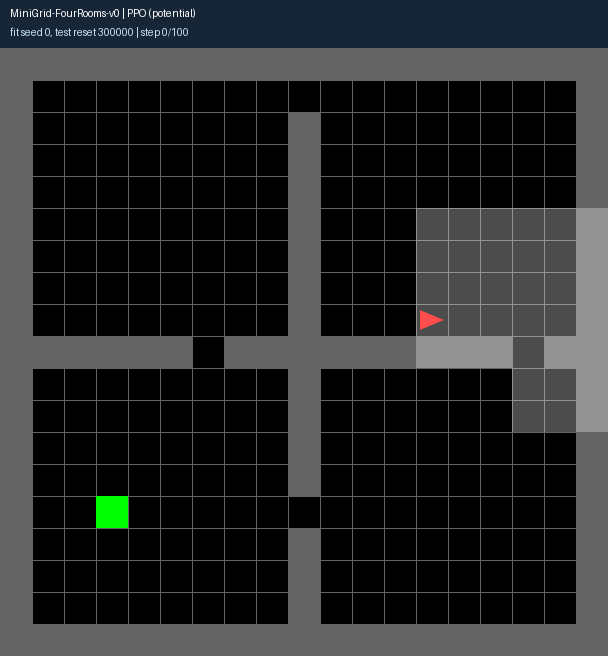

Fit 0: fixed episode return **0.000**, **100** steps.

Fit 1: fixed episode return **0.000**, **100** steps.

Fit 2: fixed episode return **0.000**, **100** steps.

### Four Rooms — PPO sparse-reward ablation

Fit 0: fixed episode return **0.000**, **100** steps.

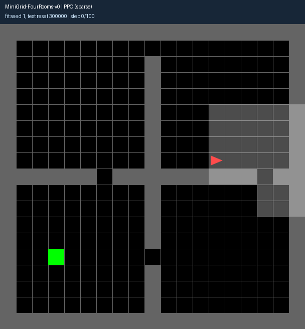

Fit 1: fixed episode return **0.000**, **100** steps.

Fit 2: fixed episode return **0.000**, **100** steps.

### Door Key — PPO sparse-reward ablation

Fit 0: fixed episode return **0.960**, **16** steps.

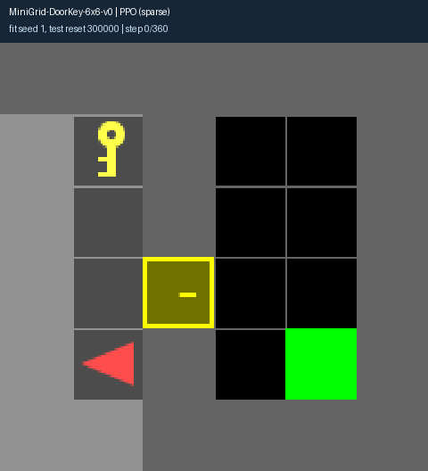

Fit 1: fixed episode return **0.000**, **360** steps.

Fit 2: fixed episode return **0.960**, **16** steps.

### Four Rooms — known-model BFS planner

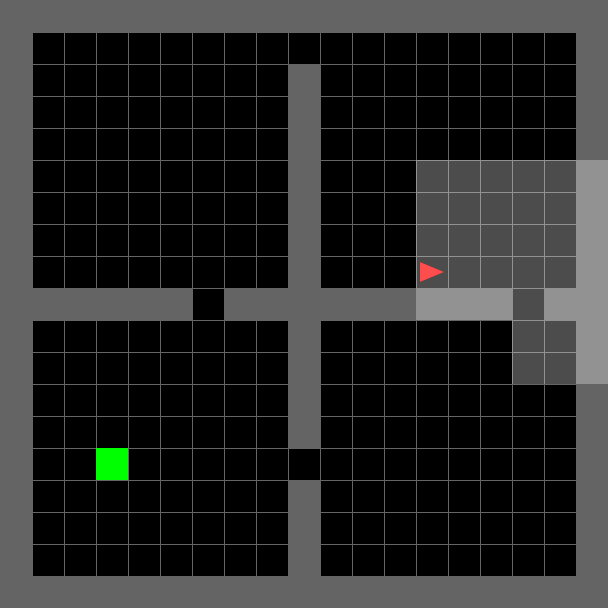

Fit reference: fixed episode return **0.784**, **24** steps.

### Door Key — known-model BFS planner

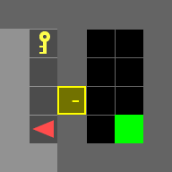

Fit reference: fixed episode return **0.965**, **14** steps.

## Continuous control

### LunarLander — PPO

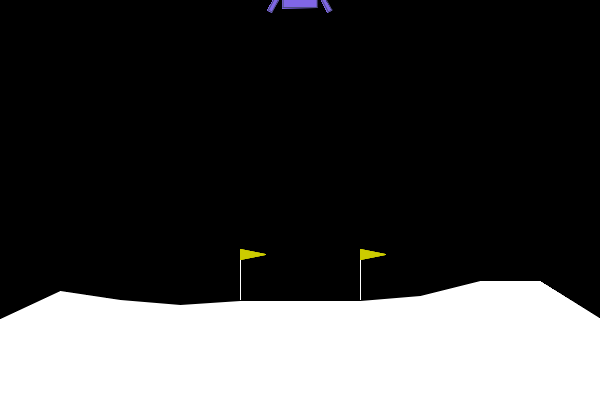

Fit 0: fixed episode return **276.791**, **212** steps.

### Official MuJoCo HalfCheetah — PPO

Fit 0: fixed episode return **1431.238**, **1000** steps.

Fit 1: fixed episode return **1569.235**, **1000** steps.

Fit 2: fixed episode return **1543.394**, **1000** steps.

### Official MuJoCo HalfCheetah — SAC

Fit 0: fixed episode return **8228.635**, **1000** steps.

Fit 1: fixed episode return **8255.437**, **1000** steps.

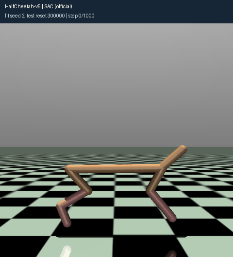

Fit 2: fixed episode return **7450.151**, **1000** steps.

## All maze fits

| Task | Training profile | Seed | Test success | Mean official return |
|---|---|---:|---:|---:|
| MiniGrid-FourRooms-v0 | potential_curriculum | 0 | 91% | 0.754 |
| MiniGrid-FourRooms-v0 | potential_curriculum | 1 | 87% | 0.717 |
| MiniGrid-FourRooms-v0 | potential_curriculum | 2 | 91% | 0.745 |
| MiniGrid-FourRooms-v0 | potential_geometry | 0 | 6% | 0.047 |
| MiniGrid-FourRooms-v0 | potential_geometry | 1 | 3% | 0.029 |
| MiniGrid-FourRooms-v0 | potential_geometry | 2 | 43% | 0.324 |
| MiniGrid-DoorKey-6x6-v0 | potential | 0 | 97% | 0.940 |
| MiniGrid-DoorKey-6x6-v0 | potential | 1 | 99% | 0.959 |
| MiniGrid-DoorKey-6x6-v0 | potential | 2 | 96% | 0.924 |
| MiniGrid-DoorKey-6x6-v0 | sparse | 0 | 100% | 0.955 |
| MiniGrid-DoorKey-6x6-v0 | sparse | 1 | 92% | 0.886 |
| MiniGrid-DoorKey-6x6-v0 | sparse | 2 | 94% | 0.910 |
| MiniGrid-FourRooms-v0 | potential | 0 | 26% | 0.219 |
| MiniGrid-FourRooms-v0 | potential | 1 | 22% | 0.165 |
| MiniGrid-FourRooms-v0 | potential | 2 | 14% | 0.129 |
| MiniGrid-FourRooms-v0 | sparse | 0 | 25% | 0.222 |
| MiniGrid-FourRooms-v0 | sparse | 1 | 25% | 0.223 |
| MiniGrid-FourRooms-v0 | sparse | 2 | 32% | 0.275 |

Each rate uses100 predetermined test layouts. Full maps and map-derived shaping are explicit training choices, so these are not default partial-view MiniGrid results. See [protocol and primary references](simulations.md) and [all comparisons](results.md).
